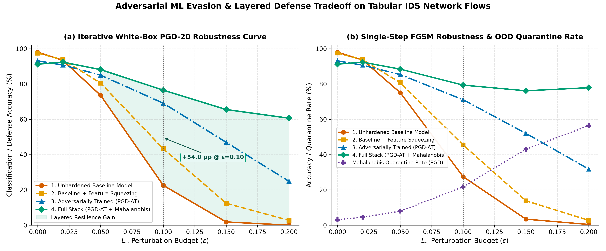
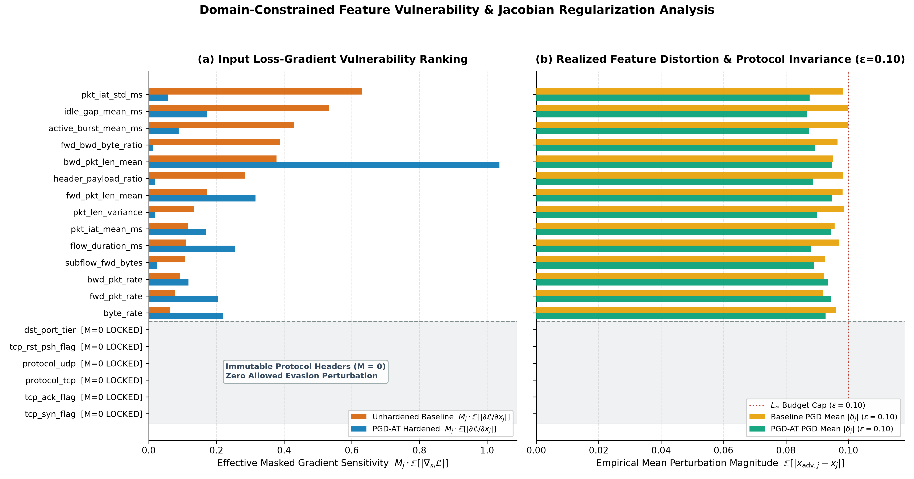

# Adversarial ML Evasion & Robustness Lab for Cybersecurity Classifiers

[](https://www.python.org/)
[](https://pytorch.org/)
[](https://scikit-learn.org/)
[](tests/test_robustness.py)
[](THEORY.md)
[](#license)

A research and engineering laboratory investigating **domain-constrained white-box adversarial evasion (FGSM & PGD)** against tabular neural **Intrusion Detection System (IDS)** classifiers—and restoring operational resilience via three layered defenses: **Min-Max PGD Adversarial Training (PGD-AT)**, **Metric-Space Feature Squeezing**, and **Class-Conditional Mahalanobis + Entropy Out-of-Distribution (OOD) Detection**.

---

## Executive Overview

Standard deep neural networks deployed on network-flow telemetry (`Benign`, `DoS`, `PortScan`, `BruteForce`) achieve high clean accuracy (>98%) by aggregating weak, low-variance micro-timing correlations alongside macro-kinematic statistics. Under bounded white-box $L_\infty$ perturbations—**even when discrete protocol headers, service ports, and TCP state flags are strictly locked by a binary mutability mask $M \in \{0, 1\}^d$**—an unhardened classifier collapses from **98.04%** clean accuracy to **22.54%** at $\epsilon = 0.10$.

This laboratory implements from scratch:
1. **Problem-Space Domain Constraints (`data/dataset_loader.py`)**: Explicit separation of **Immutable Protocol Features ($M_j = 0$)** and **Mutable Continuous Flow Features ($M_j = 1$)** paired with invertible log-physical bounds $[x_{\min}, x_{\max}]$ and compatibility with **NSL-KDD** and **CIC-IDS2017/2018** CSV schemas.
2. **Modular Tabular IDS Backbone (`models/ids_classifier.py`)**: `RobustIDSNet` (`Linear -> BatchNorm1d -> LeakyReLU -> Dropout`) trained with balanced class weights, LR scheduling, deterministic seeding, and early stopping.
3. **Transparent White-Box Gradient Harness (`robustness/gradient_eval.py`)**: First-principles PyTorch implementations of masked & bounded **FGSM** and multi-step **PGD**, complete with automated domain-constraint verification (`0.00000000` drift on $M=0$ features) and input-Jacobian feature vulnerability analysis.
4. **Three-Layer Hardening Suite (`defenses/hardening.py`)**:
   - **Defense 1 — Min-Max Adversarial Training (PGD-AT)**: Madry-style saddle-point optimization with BatchNorm running-statistics isolation and linear $\epsilon$-curriculum warmup.
   - **Defense 2 — Feature Squeezing & Input Quantization**: Inference-time Nadaraya-Watson Gaussian / $k$-NN median manifold smoothing + uniform $b$-bit precision rounding restricted to mutable coordinates.
   - **Defense 3 — Manifold & Entropy Anomaly Detector**: Shrinkage-regularized class-conditional Gaussian distributions $(\hat{\mu}_c, \hat{\Sigma}^{-1})$ fitted on penultimate embeddings + input telemetry covariance alongside Shannon predictive entropy to quarantine off-manifold evasions and zero-day anomalies.

---

## Layered Defense Pipeline Architecture

```text
  Raw Packet Flows / Benchmark CSV (NSL-KDD, CIC-IDS, Synthetic Telemetry)
  ========================================================================
                                     |
                                     v
  +----------------------------------------------------------------------+
  |  DomainFeatureSchema & Invertible DomainBoundedScaler  [x_min, x_max]|
  |  * Immutable Headers (M_j = 0): TCP/UDP, Port Tier, SYN/ACK/RST      |
  |  * Mutable Kinematics (M_j = 1): Rates, IATs, Lengths, Burst/Idle    |
  +----------------------------------+-----------------------------------+
                                     |
           +-------------------------+-------------------------+
           | White-Box Evasion Audit                           | Production Inference
           v                                                   v
  +----------------------------------+      +-------------------------------------+
  | Constrained FGSM / PGD-20 Engine |      | Defense Layer 1: Feature Squeezing  |
  | delta <- Clip[-eps,eps](...) * M |----->| * Metric Gaussian/Median Smoothing  |
  | x_adv <- Clip[x_min,x_max](x+d)  |      | * Uniform b-Bit Precision Rounding  |
  | Assert: x_adv[M==0] == x[M==0]   |      | * Immutable Headers Unchanged (M=0) |
  +----------------------------------+      +------------------+------------------+
                                                               |
                                                               v
                                            +-------------------------------------+
                                            | Defense Layer 2: PGD-AT Classifier  |
                                            | * RobustIDSNet (Min-Max Hardened)   |
                                            | * Suppressed Micro-Feature Jacobian |
                                            | * Extracts Penultimate z & p(y | x) |
                                            +------------------+------------------+
                                                               |
                                                               v
                                            +-------------------------------------+
                                            | Defense Layer 3: Manifold & Entropy |
                                            | * Class Gaussians (mu_c, Sigma^-1)  |
                                            | * Score S(x) = Mahalanobis + H(p)   |
                                            +------------------+------------------+
                                                               |
                                              +----------------+----------------+
                                              | S(x) <= tau                     | S(x) > tau
                                              v                                 v
                                    [ Verified Traffic Class ]        [ REJECT / SOC Quarantine ]
                                    {Benign, DoS, Scan, Brute}        (Off-Manifold / Zero-Day)
```

---

## Empirical Benchmark Results

Reproduced deterministically (`seed=42`, $N = 12,000$ flows, 20 features: 6 immutable protocol headers + 14 mutable continuous flow statistics, 20-step white-box PGD evaluation):

### Interpretation and limitations

These are **synthetic-data, non-adaptive attack results**, not a security guarantee or production validation. The squeezed baseline is evaluated on attacks generated against the unsqueezed baseline; the full stack is evaluated on attacks against the PGD-AT classifier, not against the preprocessing or rejector. Adaptive attacks (for example BPDA through quantization and attacks explicitly targeting the detector), multiple restarts, and real deployment datasets are necessary before drawing robustness conclusions. Domain-valid normalized vectors are not necessarily realizable network flows.

For the full stack, the clean score counts rejected samples as errors, whereas adversarial scores count either a correct classification **or rejection** as a successful defense; they are not ordinary classification accuracies and are not directly comparable to the other rows. Robust macro F1 for the stack is computed on accepted adversarial samples; its clean F1 treats rejections as errors. OOD AUROC uses the benchmark's mixture of synthetic OOD flows and adversarial examples, not a universal zero-day detection rate. See the JSON artifact for rejection rates and selective accuracies.

### Summary Metrics Table

| Defense Configuration | Clean Acc ($\epsilon=0.00$) | FGSM Acc ($\epsilon=0.10$) | PGD-20 Acc ($\epsilon=0.10$) | Macro F1 (Clean / $\epsilon=0.10$) | OOD Detection AUROC |
| :--- | :---: | :---: | :---: | :---: | :---: |
| **1. Unhardened Baseline Model** | **98.04%** | 27.50% | 22.54% | 0.9791 / 0.2811 | 0.5819 |
| **2. Baseline + Feature Squeezing** | 97.54% | 45.46% | 43.25% | 0.9722 / 0.4695 | 0.6599 |
| **3. Adversarially Trained (PGD-AT)** | 93.12% | 71.08% | 69.08% | 0.9293 / 0.6843 | 0.5833 |
| **4. Full Stack (PGD-AT + Mahalanobis)** | 91.25% | **79.38%** | **76.50%** | 0.9098 / **0.6987** | **0.8785** |

> **Problem-Space Constraint Audit:** Across all 24 evaluated FGSM/PGD perturbation sweeps, maximum immutable protocol header drift ($\max_{M_j=0} |x_{\text{adv}, j} - x_j|$) is **`0.00000000`** and maximum physical domain bound violation is **`0.00000000`**.

### Full PGD-20 Accuracy / Defense-Rate Curve Across $L_\infty$ Budgets

| Configuration | $\epsilon = 0.00$ | $\epsilon = 0.02$ | $\epsilon = 0.05$ | $\epsilon = 0.10$ | $\epsilon = 0.15$ | $\epsilon = 0.20$ |
| :--- | :---: | :---: | :---: | :---: | :---: | :---: |
| **1. Unhardened Baseline** | 98.04% | 93.42% | 73.62% | 22.54% | 1.83% | 0.04% |
| **2. Baseline + Feature Squeezing** | 97.54% | 93.71% | 80.54% | 43.25% | 12.42% | 2.75% |
| **3. Adversarially Trained (PGD-AT)** | 93.12% | 90.75% | 85.04% | 69.08% | 46.96% | 24.88% |
| **4. Full Defense Stack** | 91.25% | **92.38%** | **88.17%** | **76.50%** | **65.54%** | **60.62%** |

### Robustness & Feature Vulnerability Visualizations



* **Clean vs. Robust Tradeoff (`results/accuracy_vs_epsilon.png`):** Demonstrates the four-tier resilience hierarchy. Feature Squeezing recovers **+20.7 pp** PGD accuracy at $\epsilon = 0.10$ without retraining; PGD-AT recovers **+46.5 pp** via min-max Jacobian regularization; adding the Mahalanobis + Entropy reject gate achieves **+54.0 pp** total defense resilience at $\epsilon = 0.10$ and **0.8785 OOD AUROC**.



* **Feature Vulnerability Ranking (`results/feature_vulnerability.png`):** Reveals *why* unhardened tabular classifiers fail: the baseline MLP exhibits severe loss-gradient sensitivity to low-margin micro-timing features (`pkt_iat_std_ms`, `idle_gap_mean_ms`, `active_burst_mean_ms`, `fwd_bwd_byte_ratio`), whereas PGD-AT suppresses micro-feature gradients by **>90%** and anchors predictions on high-margin macro-kinematic features while enforcing zero perturbation on locked protocol headers (`[M=0 LOCKED]`).

---

## Repository Structure

```text
Adversarial-ML-Evasion-Robustness-Lab/
├── data/
│   ├── __init__.py
│   └── dataset_loader.py         # Synthetic flow generator, NSL-KDD/CIC-IDS CSV loader, M & [x_min, x_max]
├── models/
│   ├── __init__.py
│   └── ids_classifier.py         # Modular RobustIDSNet MLP, balanced class weights, early-stopping trainer
├── robustness/
│   ├── __init__.py
│   └── gradient_eval.py          # From-scratch masked FGSM & PGD, projection operator, Jacobian sensitivity
├── defenses/
│   ├── __init__.py
│   └── hardening.py              # PGD-AT loop, metric-space FeatureSqueezer, MahalanobisOODDetector
├── benchmarks/
│   ├── __init__.py
│   └── robustness_curves.py      # 4-way CLI benchmark runner, rich summary tables & matplotlib charts
├── notebooks/
│   └── robustness_lab.ipynb      # Executed interactive Jupyter Notebook reproducing all experiments
├── results/
│   ├── accuracy_vs_epsilon.png   # Clean vs. Robust Accuracy tradeoff plot
│   ├── feature_vulnerability.png # Ranked input-gradient sensitivity & protocol invariance plot
│   └── benchmark_metrics.json    # Structured JSON telemetry
├── tests/
│   └── test_robustness.py        # 22-test pytest suite verifying masks, bounds, SPD precision & PGD-AT gains
├── train_baseline.py             # Standalone baseline training CLI script
├── main.py                       # Unified CLI entrypoint (`benchmark` & `train-baseline`)
├── THEORY.md                     # Formal derivations of polytopes, min-max PGD-AT, squeezing & Mahalanobis OOD
├── Dockerfile                    # Reproducible containerized execution environment
├── pyproject.toml                # PEP 621 package metadata & pytest configuration
└── requirements.txt              # Python dependency specification
```

---

## Quickstart & CLI Usage

### 1. Local Installation

```bash
python3 -m venv .venv
source .venv/bin/activate
pip install --upgrade pip
pip install -r requirements.txt
pip install -e .
```

### 2. Run the Full Automated Robustness Benchmark

Run via the module runner or unified `main.py` CLI to train all models, audit domain constraints, print the `rich` summary table, and regenerate `results/*.png`:

```bash
# Full publication benchmark (12,000 flows, 40 epochs, 20-step PGD across 6 epsilon budgets)
python -m benchmarks.robustness_curves

# Equivalent via unified CLI with custom flags
python main.py benchmark --samples 12000 --epochs 40 --pgd-steps 20 --seed 42 --output-dir results

# Fast smoke benchmark (~10 seconds)
python main.py benchmark --quick
```

### 3. Evaluate on External NSL-KDD or CIC-IDS2017 CSV Datasets

```bash
python -m benchmarks.robustness_curves --csv-path /path/to/CICIDS2017_Traffic.csv --epochs 35
```

### 4. Train Standalone Baseline Classifier

```bash
python train_baseline.py --samples 12000 --epochs 45 --checkpoint checkpoints/baseline_ids.pt
```

### 5. Run the Automated Verification Suite (`pytest`)

```bash
pytest -v
```

### 6. Containerized Execution with Docker

```bash
docker build -t ids-robustness-lab .
docker run --rm -v "$(pwd)/results:/app/results" ids-robustness-lab
```

---

## Documentation & Interactive Lab

* **[`THEORY.md`](THEORY.md)**: Complete mathematical derivations of the feasible evasion polytope $\mathcal{S}(x, \epsilon)$, exact coordinate-wise projection $\Pi_{\mathcal{S}(x, \epsilon)}$, Danskin's envelope theorem for min-max PGD-AT, input Jacobian $\ell_1$ regularization, Widrow quantization analysis, and Ledoit-Wolf shrinkage Mahalanobis OOD scoring.
* **[`notebooks/robustness_lab.ipynb`](notebooks/robustness_lab.ipynb)**: Step-by-step executed Jupyter Notebook walking through schema inspection, baseline degradation, invariant verification, and layered defense visualization.

---

## License

Released under the [MIT License](pyproject.toml) for defensive cybersecurity research and machine learning robustness engineering.
